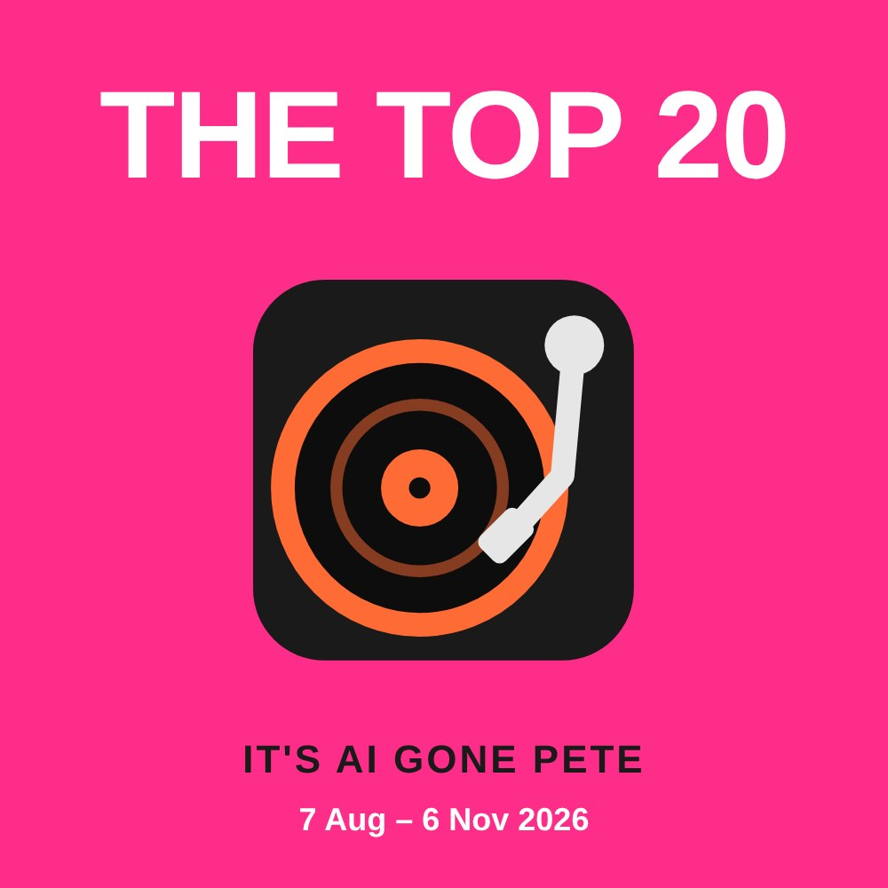
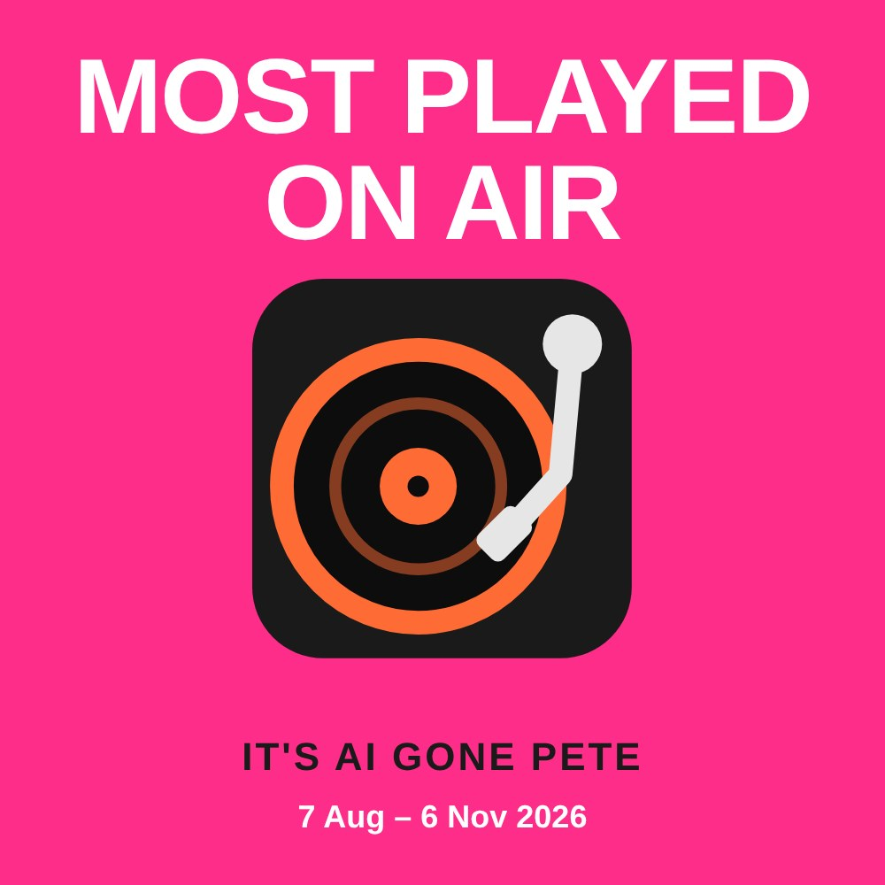
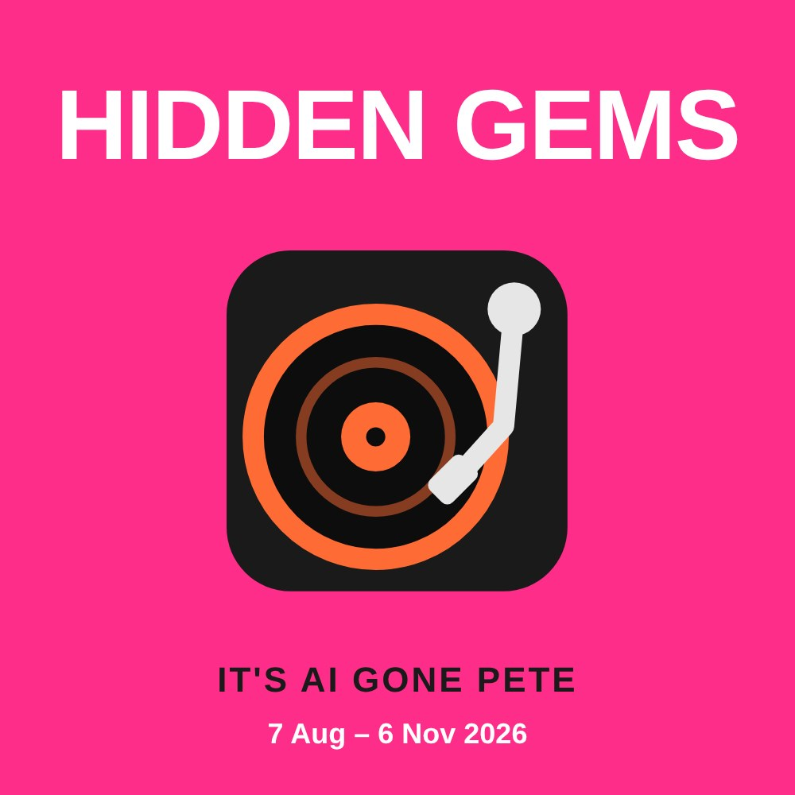
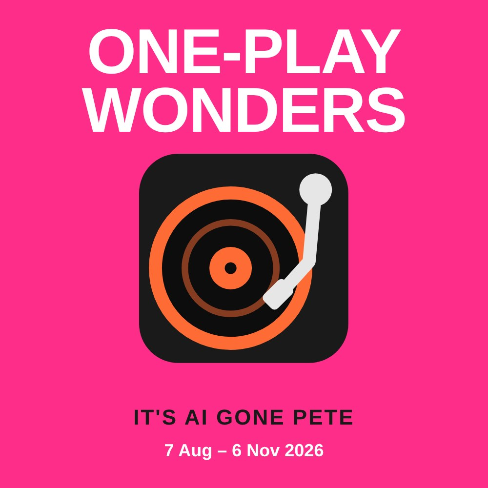
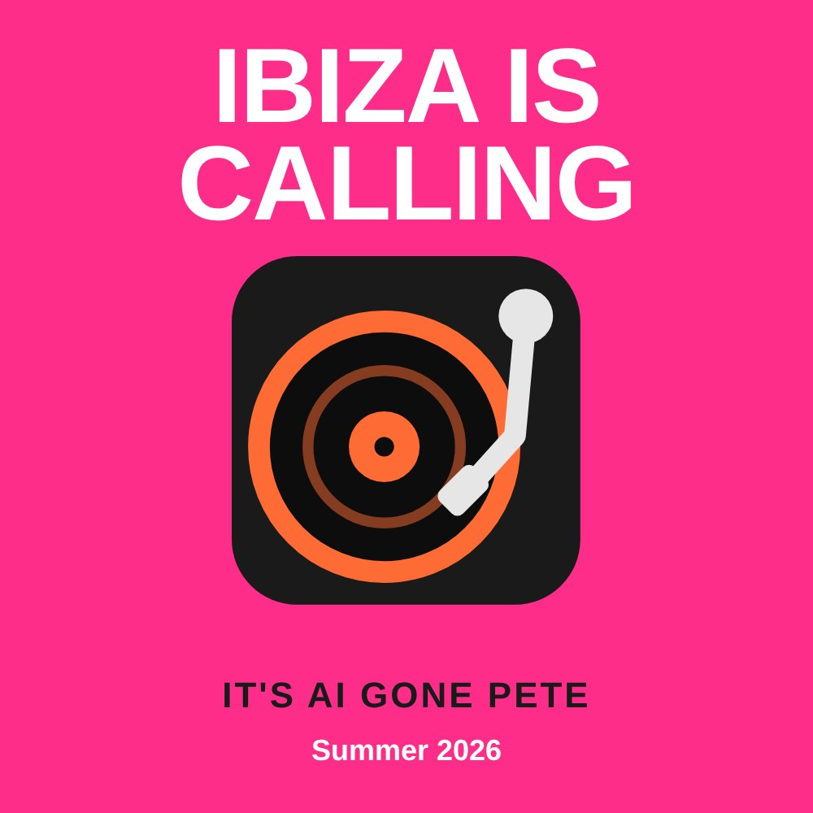
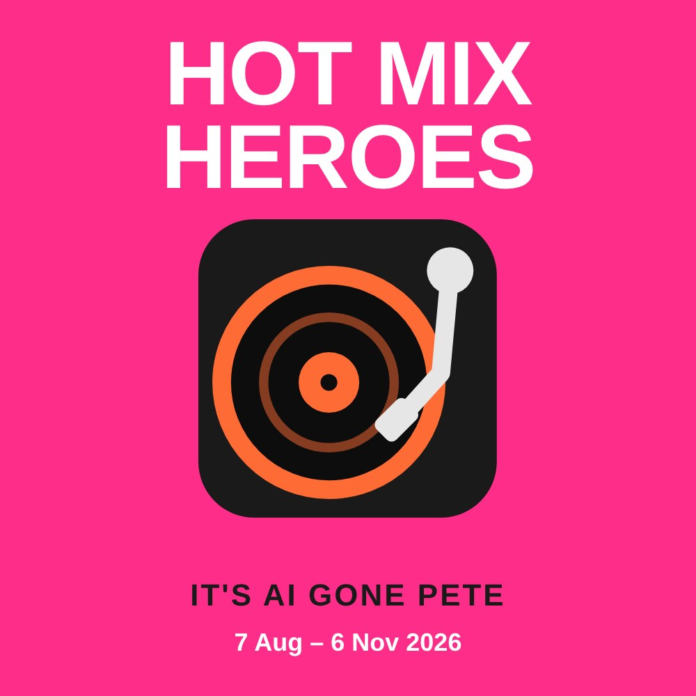
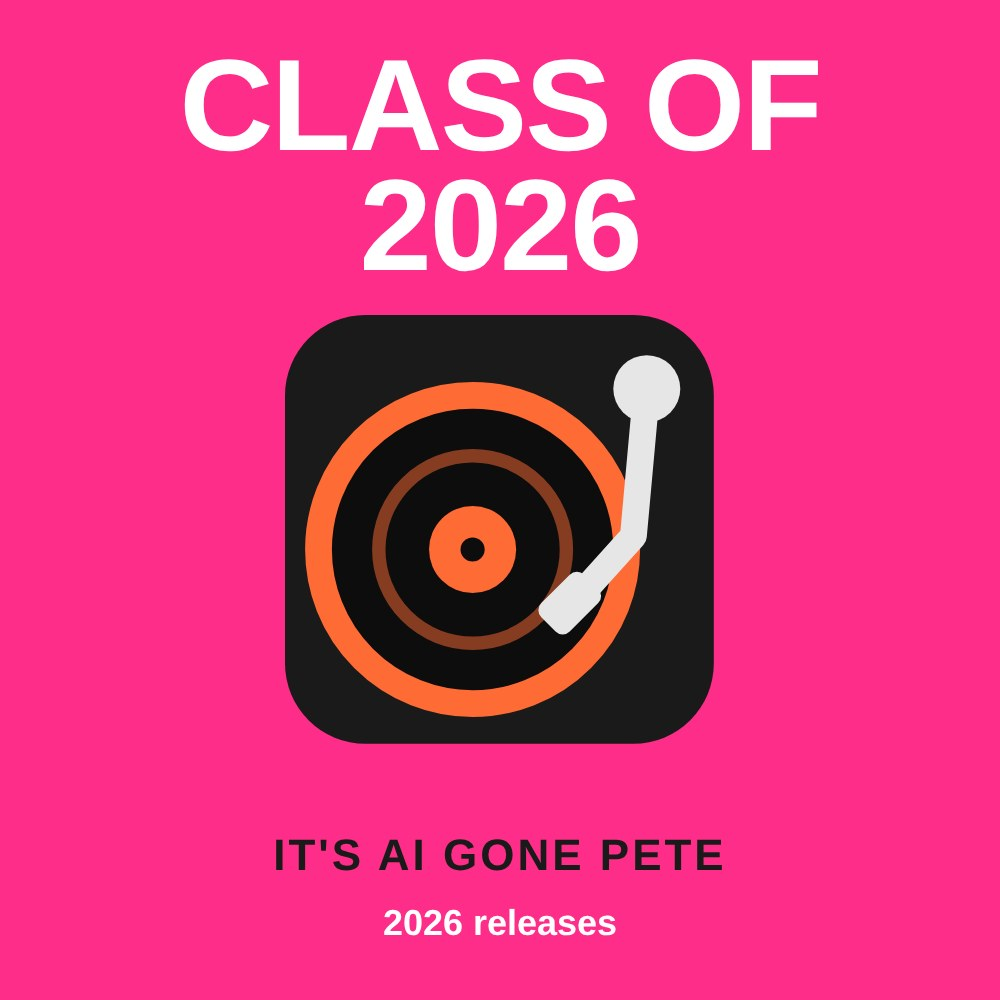
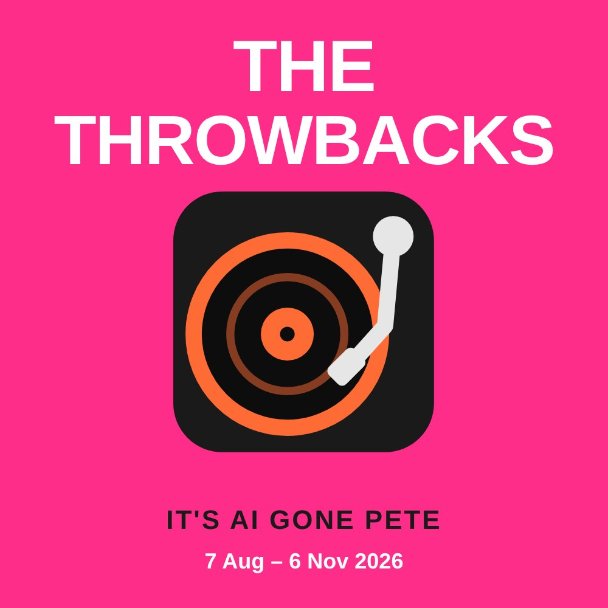

# Instagram posts – @petetongisai

Status: **draft, awaiting review**. Nothing has been posted.
Planned for: Friday 20 Nov 2026, around Pete Tong's Radio 1 show (22:00–00:00 UK).

Bio link: https://open.spotify.com/user/31z6eksx5qfpag7yj26cof6rdjby
Bio line: AI-curated playlists from Pete Tong's Radio 1 shows. Fan project, not affiliated with Pete Tong or the BBC.

Instagram allows max 5 hashtags per post; links in captions aren't clickable, so captions say "link in bio".

## 1. The Top 20

**Playlist:** https://open.spotify.com/playlist/1KjjOmUPCFF1RYZwrK8GtA

**Caption:**

> The chart 📈 The 20 most-streamed tracks from Pete Tong's Radio 1 shows, Aug–Nov 2026, from No. 1 to No. 20. Playlist link in bio. AI-curated fan project, not affiliated with Pete Tong or the BBC.

**Hashtags:** #PeteTong #ItsAIGonePete #Radio1Dance #HouseMusic #DanceMusic

## 2. Most Played on Air

**Playlist:** https://open.spotify.com/playlist/6928VNeBa18xoMPmRoisNe

**Caption:**

> The tracks Pete couldn't stop playing 🔁 His 20 most-played on air, Aug–Nov 2026. Link in bio. AI-curated fan project.

**Hashtags:** #PeteTong #ItsAIGonePete #Radio1Dance #HouseMusic #DJ

## 3. Hidden Gems

**Playlist:** https://open.spotify.com/playlist/6zcnaDk99eKtzv3LCr4BCc

**Caption:**

> Dig deeper 💎 The 20 least-streamed tracks Pete played this autumn, so you might not know them yet. Link in bio. AI-curated fan project.

**Hashtags:** #PeteTong #ItsAIGonePete #Radio1Dance #DeepHouse #Underground

## 4. One-Play Wonders

**Playlist:** https://open.spotify.com/playlist/3kQRqPyXcarHvFULN1Tuwm

**Caption:**

> Played once, never forgotten ✨ Tracks that got just one spin on the show. Link in bio. AI-curated fan project.

**Hashtags:** #PeteTong #ItsAIGonePete #Radio1Dance #HouseMusic #NewMusic

## 5. Ibiza Is Calling

**Playlist:** https://open.spotify.com/playlist/1hUFLWrBkbuqgyVBegDXQ4

**Caption:**

> Still dreaming of the White Isle 🌅 The best of Pete's Ibiza Is Calling shows, summer 2026. Link in bio. AI-curated fan project.

**Hashtags:** #PeteTong #ItsAIGonePete #Radio1Dance #Ibiza #IbizaMusic

## 6. Hot Mix Heroes

**Playlist:** https://open.spotify.com/playlist/2WZmevNEIVrUPxy8vRFYhF

**Caption:**

> Tracks from the guest DJs who took over the Hot Mix 🔥 Dusky, ANOTR, Adam Beyer and more. Link in bio. AI-curated fan project.

**Hashtags:** #PeteTong #ItsAIGonePete #Radio1Dance #Techno #Dusky

## 7. Class of 2026

**Playlist:** https://open.spotify.com/playlist/7tiuq8tvhpae0h0jHtkPqY

**Caption:**

> This year's freshest 🆕 The top 2026 releases Pete played on Radio 1. Link in bio. AI-curated fan project.

**Hashtags:** #PeteTong #ItsAIGonePete #Radio1Dance #NewMusicFriday #NewMusic

## 8. The Throwbacks

**Playlist:** https://open.spotify.com/playlist/6jG3l9ELi7ZP2mNvMX3QNu

**Caption:**

> Back to where it started ⏪ The 20 oldest records Pete dropped this autumn, from Chicago to Cybotron. Link in bio. AI-curated fan project.

**Hashtags:** #PeteTong #ItsAIGonePete #Radio1Dance #ClassicHouse #90sHouse
